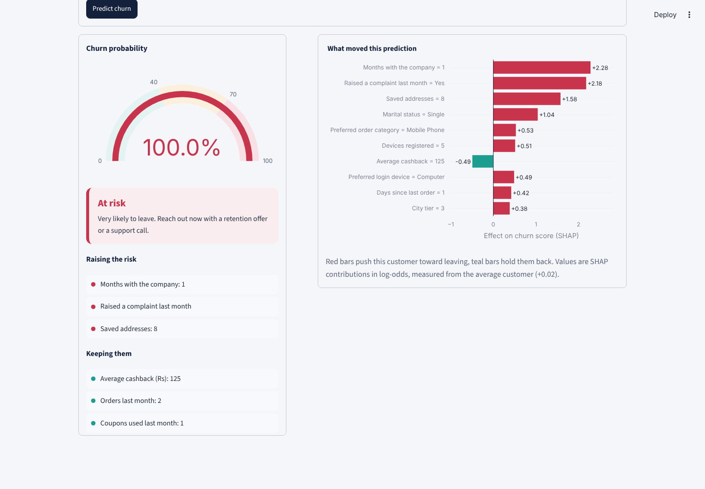
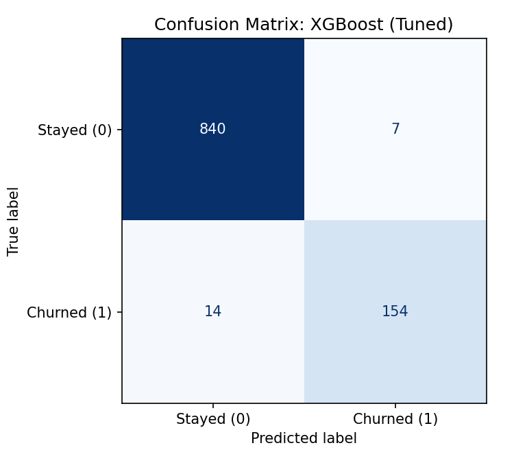
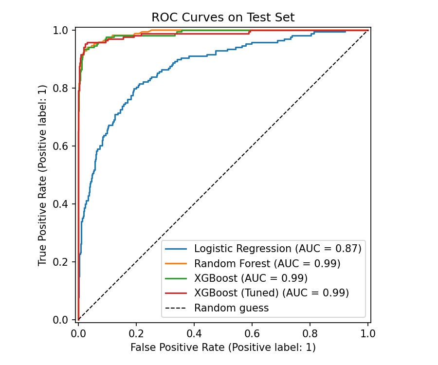
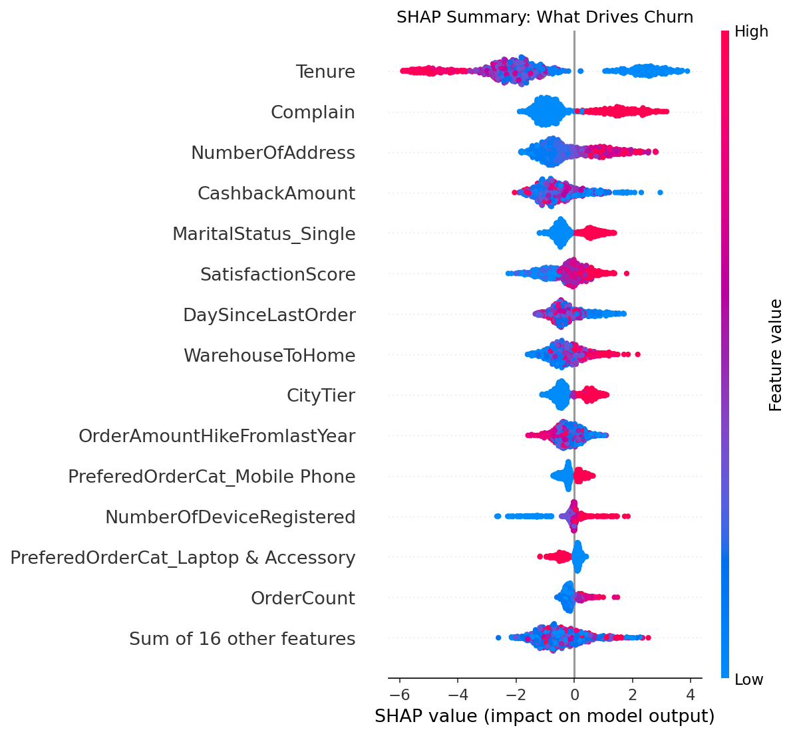
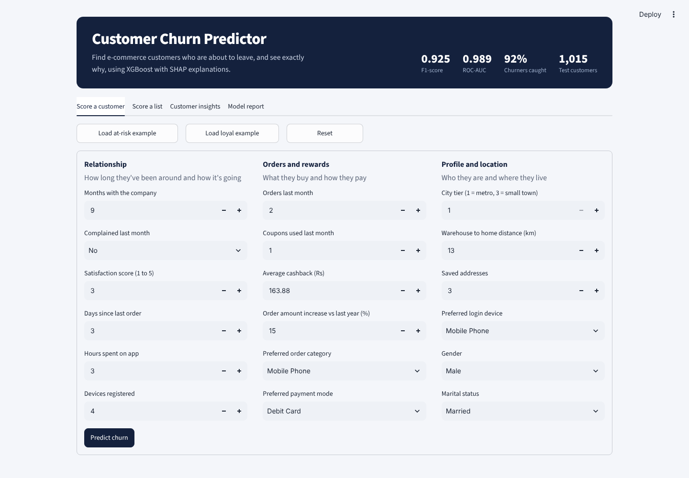
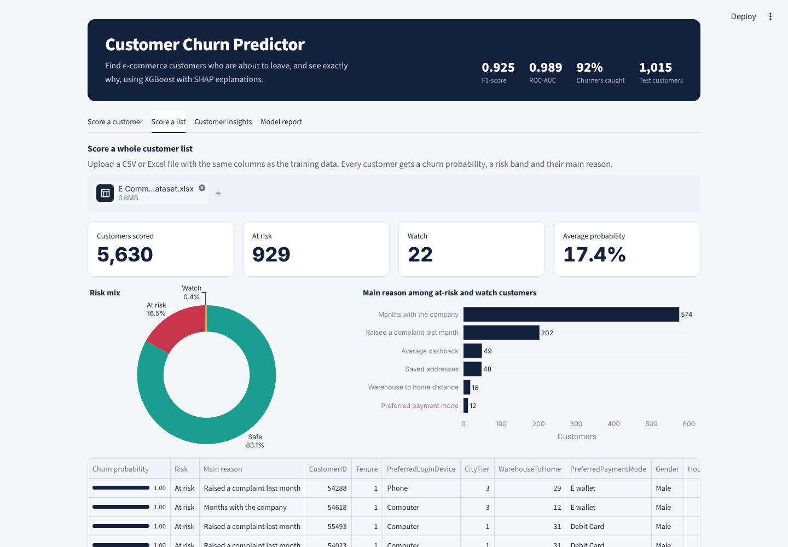
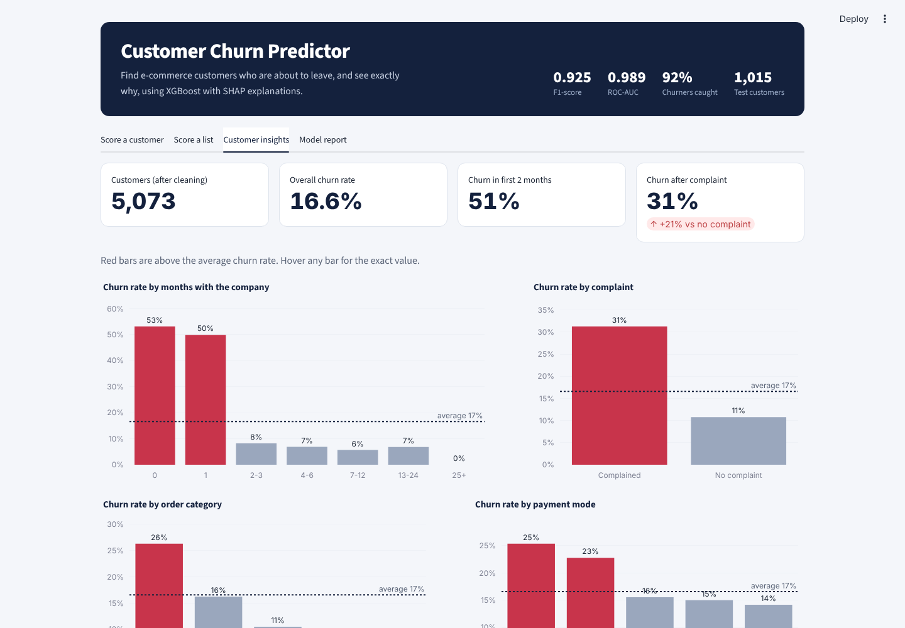
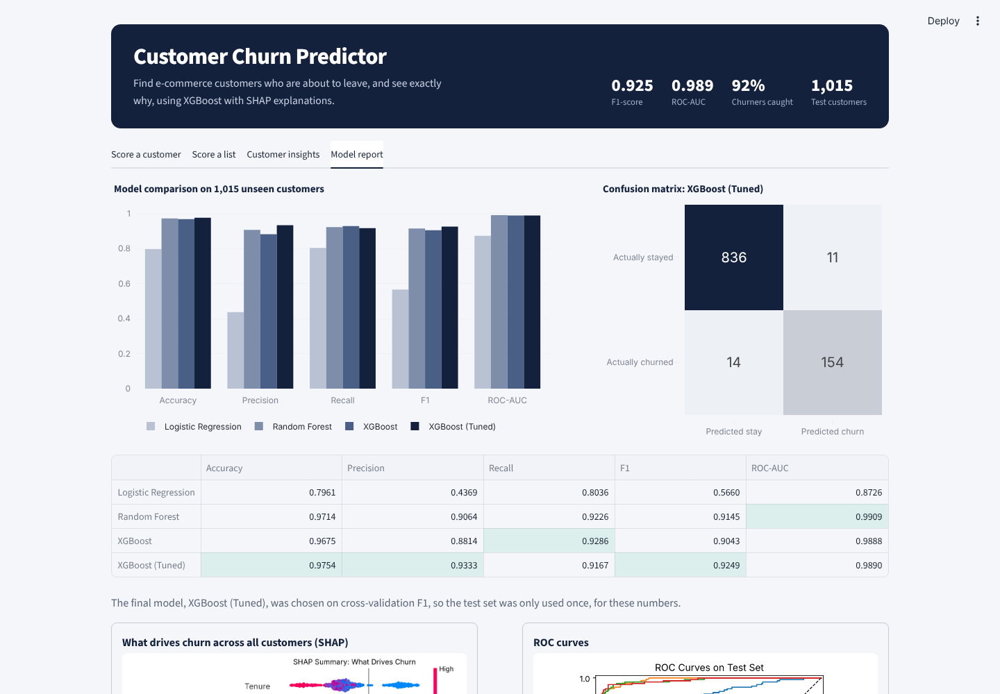

   # ChurnLens: Explainable Customer Churn Prediction for E-Commerce

Predicts which customers of an online store are likely to stop buying (churn) and explains **why** for each customer, using XGBoost for prediction and SHAP for explainability. Includes a Streamlit web app for real-time predictions.

**AI & Data Science II Mini Project** | Atharva Pagar | BE IT | Atharva College of Engineering, University of Mumbai



---

## Problem

Getting a new customer costs much more than keeping an existing one. If a company can spot customers who are about to leave, it can act early with offers, support or follow-ups. Most churn models only give a yes/no answer, which does not tell the business what to fix. This project predicts churn **and** shows the reasons behind every prediction.

## Dataset

[E-Commerce Customer Churn Analysis and Prediction](https://www.kaggle.com/datasets/ankitverma2010/ecommerce-customer-churn-analysis-and-prediction) (Kaggle)

| | |
|---|---|
| Raw rows | 5,630 customers, 20 columns |
| After cleaning | 5,073 customers, 18 features |
| Target | `Churn` (1 = left, 0 = stayed) |
| Churn rate | 16.6% (imbalanced) |

Features include tenure, complaints, satisfaction score, cashback, order count, days since last order, payment mode, preferred order category, city tier and marital status.

## Approach

1. **EDA and cleaning** ([notebooks/01_EDA.ipynb](notebooks/01_EDA.ipynb))
   - 7 columns had about 5% missing values. Missing values were linked to churn, so rows were kept and filled with the median inside the model pipeline (fitted on training data only).
   - Removed 557 duplicate customers (identical apart from the ID) so the same customer cannot appear in both train and test.
   - Merged inconsistent labels: `Phone`/`Mobile Phone`, `CC`/`Credit Card`, `COD`/`Cash on Delivery`, `Mobile`/`Mobile Phone`.
2. **Preprocessing:** median/mode imputation, standard scaling, one-hot encoding, all inside a scikit-learn `Pipeline`.
3. **Imbalance:** class weights (`class_weight="balanced"`, `scale_pos_weight`) instead of oversampling.
4. **Models:** Logistic Regression (baseline), Random Forest, XGBoost, and XGBoost tuned with `RandomizedSearchCV` (30 settings, 5-fold stratified CV, optimising F1).
5. **Evaluation:** stratified 80/20 split. The final model is chosen on cross-validation F1, so the test set is only used once for reporting.
6. **Explainability:** SHAP `TreeExplainer` for global feature importance and per-customer explanations.

## Results

Test set: 1,015 customers the model never saw during training.

| Model | Accuracy | Precision | Recall | F1 | ROC-AUC |
|---|---|---|---|---|---|
| Logistic Regression | 0.7961 | 0.4369 | 0.8036 | 0.5660 | 0.8726 |
| Random Forest | 0.9714 | 0.9064 | 0.9226 | 0.9145 | **0.9909** |
| XGBoost | 0.9675 | 0.8814 | 0.9286 | 0.9043 | 0.9888 |
| **XGBoost (Tuned)** | **0.9754** | **0.9333** | 0.9167 | **0.9249** | 0.9890 |

**Final model: Tuned XGBoost.** It has the best F1-score. Random Forest has a marginally higher ROC-AUC (0.9909 vs 0.9890), but the difference is very small, and XGBoost is better on F1, precision and accuracy.

**Confusion matrix (Tuned XGBoost):** of 168 actual churners, 154 were caught and 14 were missed. Only 11 of 847 loyal customers were wrongly flagged.

| | Predicted: Stayed | Predicted: Churned |
|---|---|---|
| **Actual: Stayed** | 836 | 11 |
| **Actual: Churned** | 14 | 154 |

<p>


</p>

### What drives churn (SHAP)



1. **Tenure** is the strongest factor. New customers (0 to 1 month) are at the highest risk. About half of them churn, while customers with 25+ months almost never do.
2. **Complaints:** customers who complained churn about 3 times more often (31% vs 11%).
3. **Number of saved addresses:** more addresses push risk up.
4. **Cashback:** lower cashback is linked to higher churn.
5. **Marital status:** single customers churn more.

**Limitation noted during EDA:** in this dataset a higher satisfaction score goes with *more* churn (11.5% at score 1 vs 23.1% at score 5). This is counter-intuitive and may mean the survey was taken at a different time from the churn label.

## Web App

A Streamlit dashboard with interactive Plotly charts. Four tabs:

| Tab | What it does |
|---|---|
| **Score a customer** | Fill in a customer's details (or load the at-risk / loyal example), get a churn probability gauge, a risk band (Safe / Watch / At risk), the top reasons for and against churn, and a SHAP chart of what moved the prediction |
| **Score a list** | Upload a CSV/Excel of many customers, get each one's probability, risk band and main reason, a risk mix chart, and a downloadable scored list |
| **Customer insights** | Interactive EDA: churn rate by tenure, complaints, order category, payment mode, marital status and satisfaction |
| **Model report** | Model comparison chart, confusion matrix, metrics table, SHAP summary and ROC curves |

| Score a customer | Score a list |
|---|---|
|  |  |

| Customer insights | Model report |
|---|---|
|  |  |

## Project Structure

```
churn-project/
├── app.py                    Streamlit web app
├── assets/style.css          dashboard styling
├── data/
│   ├── E Commerce Dataset.xlsx       raw data from Kaggle
│   └── ecommerce_churn_clean.csv     cleaned data (from the notebook)
├── notebooks/
│   └── 01_EDA.ipynb          exploratory data analysis with notes
├── src/
│   ├── config.py             paths, feature lists, labels
│   ├── data_prep.py          loading and cleaning
│   ├── train.py              training, tuning, evaluation, plots
│   └── explain.py            SHAP helpers used by train.py and app.py
├── models/
│   ├── churn_model.joblib    final pipeline (preprocessing + model)
│   ├── metrics.json          scores for every model
│   └── feature_info.json     input ranges for the app form
├── reports/figures/          confusion matrix, ROC, SHAP plots
├── docs/screenshots/         app screenshots
└── requirements.txt
```

## How to Run

Requires Python 3.10 or newer.

```bash
git clone https://github.com/<your-username>/churn-project.git
cd churn-project

python -m venv venv
venv\Scripts\activate          # Windows
# source venv/bin/activate     # macOS / Linux

pip install -r requirements.txt
```

The dataset is already in `data/`. If it is missing, download it from Kaggle and place `E Commerce Dataset.xlsx` in that folder.

```bash
# 1. (optional) explore the data
jupyter notebook notebooks/01_EDA.ipynb

# 2. train the models (about 1 to 2 minutes)
python -m src.train

# 3. start the web app
streamlit run app.py
```

The app opens at http://localhost:8501.

> Re-run `python -m src.train` once after installing so the saved model matches your installed library versions.

## Tech Stack

Python, Pandas, NumPy, scikit-learn, XGBoost, SHAP, Matplotlib, Seaborn, Plotly, Streamlit, Jupyter

## References

1. I. Ekanayake and S. De Alwis, "Explainability, risk modeling, and segmentation based customer churn analytics for personalized retention in e-commerce," arXiv:2510.11604, 2025. [Link](https://arxiv.org/abs/2510.11604)
2. D. Asif, M. S. Arif and A. Mukheimer, "A data-driven approach with explainable artificial intelligence for customer churn prediction in the telecommunications industry," *Results in Engineering*, vol. 26, 104629, 2025. [Link](https://doi.org/10.1016/j.rineng.2025.104629)
3. "Explainable AI-driven customer churn prediction: a multi-model ensemble approach with SHAP-based feature analysis," 2025. [Link](https://www.ncbi.nlm.nih.gov/pmc/articles/PMC12929532/)
4. "Explainable Customer Churn Prediction in Telecom Using Ensemble Learning and SHAP Analysis," *Mathematical Modelling of Engineering Problems*, 2025. [Link](https://doi.org/10.18280/mmep.121226)
5. "Prediction of bank credit customers churn based on machine learning," *Data Science in Finance and Economics*, vol. 5, no. 1, 2025. [Link](https://www.aimspress.com/aimspress-data/dsfe/2025/1/PDF/DSFE-05-01-002.pdf)
6. S. M. Lundberg and S.-I. Lee, "A Unified Approach to Interpreting Model Predictions," NeurIPS, 2017.
7. T. Chen and C. Guestrin, "XGBoost: A Scalable Tree Boosting System," KDD, 2016.

## License

MIT
